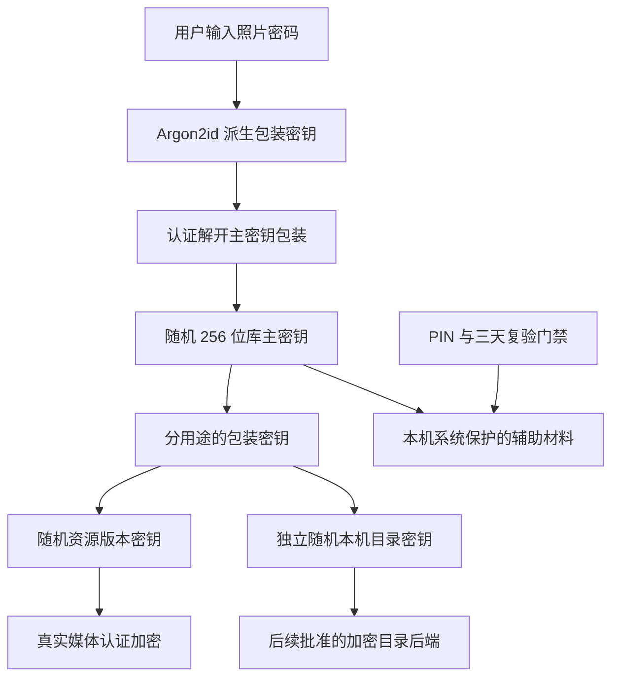

# Security Foundation Review

2026-11-11 用户明确批准 WBL-1：Windows 最小化／手动应用锁仅撤销界面访问，已解锁进程保留后台所需密钥、加密目录和仓库会话，继续来源发现、导入、加密、上传及校验；72 小时到期、时间异常、系统锁屏／睡眠、退出／重启仍停止后台并撤销会话。手动暂停不因解锁解除。详见 windows-background-lock.md，旧 SFR-1／WSR-1 的普通锁暂停条款仅在此 Windows 范围被替换；iOS 不变。批准不等于验收。

以下原批准记录保留历史；普通锁的现行 Windows 行为以 WBL-1 为准。

## Status and Approval Boundary

2026-11-09，用户逐组明确批准 `SFR-1`：第一组“同意 SFR-1 的 TD01–TD04”；第二组“同意上述密码与恢复规则”（TD05）；第三组“同意 SFR-1 的 TD06”。本文六组方案、参数、候选依赖版本、失败语义及验证门槛现为已批准实施约定，无偏离项。下文沿用的“建议／Candidate”是评审原文，不再表示选项未定；批准不等于实现或平台验收完成。

本文件补充 technical-decisions.md，不覆盖既有产品规则。SQLCipher 仍仅获准验证；仓库传输／对象／分块协议、删除策略、额外相册跨设备同步仍按原门槛处理，不随本安全方案批准。

## Review Summary

| 决策 | 本次具体建议 | 主要代价／替代方案 | 状态 |
| --- | --- | --- | --- |
| TD01 | libsodium 的 XChaCha20-Poly1305；32 字节密钥、24 字节随机 nonce、16 字节认证标签 | 依赖原生库及绑定；不自动替换为 AES-256-GCM | 已批准，待实现验收 |
| TD02 | Argon2id 1.3；64 MiB、3 次、1 lane、16 字节随机盐、32 字节输出；固定版本化参数 | 双端必须测实际耗时／内存，失败不得降级 | 已批准，待实现验收 |
| TD03 | 随机库主密钥，经照片密码派生密钥保护；本机目录密钥独立随机；资源密钥逐资源版本生成并分用途保护 | 主密钥泄漏影响较大，完整轮换不自动加入 | 已批准，待实现验收 |
| TD04 | 原生 Windows 用户范围 DPAPI、iOS 本设备且设备解锁时可访问的 Keychain；辅助材料与期限受保护 | 两端原生适配需实测，不自动替换插件 | 已批准，待实现验收 |
| TD05 | 12–128 个 Unicode 标量的照片密码；遗忘不能重置解密；正确照片密码可重设 PIN；改照片密码需旧密码并重新包装 | 改密码不撤销已复制主密钥／历史材料 | 已批准，待实现验收 |
| TD06 | 普通锁也暂停同步；规定锁触发与重试；每台设备独立 72 小时；时间异常要求照片密码；到期取消在途并核对 | 上锁期间同步暂停、后台返回需 PIN | 已批准，待实现验收 |

## Threat Model

| 资产／对手能力 | 本方案应达到的保护 | 无法据此承诺的保护 |
| --- | --- | --- |
| 仅取得 GitHub/Gitee 仓库密文、提交历史或仓库访问令牌 | 没有照片密码或有效解密材料时不能直接取得明文；认证失败拒绝资源 | 仓库平台仍可能观察对象数量、大小和时间；流量填充及公开字段在 TD10 评审，当前不确定远端协议 |
| 篡改密文、资源绑定、格式头或提供超大 KDF 参数 | 先做有界解析，再认证；不输出未验证明文，不执行任意资源消耗参数 | 认证加密本身不证明“这是最新版本”；仓库回退／重放完整策略在 TD11，不宣称已解决 |
| 复制 App 管理目录但没有系统解锁材料 | 元数据、辅助材料及凭据不得明文保存；照片密码路径仍需实际派生／认证 | Windows 用户指定原照片目录按既定要求保留普通原文件，App 加密不覆盖这些原文件 |
| 在正常 App 界面尝试 PIN、返回、旧页面或旧异步回调 | 强制访问门禁、持久化重试限制、会话撤销，不能凭 PIN 延长期限 | 四位 PIN 不是抵抗离线穷举的数据加密密钥 |
| 本机同一已登录用户权限、进程注入、管理员／越狱／内核控制 | 减少秘密拷贝、限制生命周期、不主动记录秘密 | 不承诺抵御已控制解密端的攻击者；DPAPI 不提供本 App 独占的进程隔离 [S6] |
| 删除远端、破坏本机受保护状态、时钟或完整系统快照回退 | 保留原数据；无法确认状态时要求重新输入照片密码，不自动初始化 | 无外部可信状态时不能保证识别任意完整快照回退；加密不保证备份可用性，也不撤回已发送字节 |

密码、PIN、原始密钥、令牌及私有媒体不进入日志、异常文本、遥测或测试报告。Dart 输入字符串、系统输入法、内存转储和休眠镜像不能承诺完全零残留；不擅自修改用户系统配置。采用原生可释放敏感缓冲区并及时释放，不能以普通字符串置空宣称已安全擦除 [S8]。

## TD01 — Authenticated Encryption Candidate

建议固定套件标识 `epa-xchacha20poly1305-v1`，调用成熟实现，不自行实现轮函数或 MAC。

- XChaCha20-Poly1305 IETF API；密钥 32 字节，nonce 24 字节，标签 16 字节。nonce 每次实际加密由 libsodium `randombytes_buf` 生成，不使用时间、文件名、PIN 或普通伪随机数 [S1/S9]。
- 同一密钥与 nonce 不能用于两次不同加密。重发复用已完成密文字节；重新生成密文时重新生成 nonce。资源内容版本变化产生新资源密钥；仓库中如何识别该版本仍由 TD11 决定。
- 认证关联数据包含用途、版本和所属对象身份。密钥包装绑定库 ID／包装版本；资源调用须由上层传入库、资源和内容版本的认证上下文。不能只认证数据而允许把另一个库的包装或另一资源的密文替换进来。
- AAD 的媒体／块布局、顺序、完整清单和发布格式在 TD10/TD11 批准前不定案。阶段一只提供真实密码学原语、密钥包装和明确要求调用方提供的上下文，不声称完成媒体文件协议。
- 认证完成前不向调用方、播放器或导出目标释放该认证单元的明文；错误密钥、nonce、标签、AAD 或损坏均失败。资源多块完整性仍须阶段四整体校验。
- 分别报告格式不支持、长度不合法、后端不可用和认证失败。认证失败统一提示“密码错误或受保护材料已损坏”，不得假装能仅从失败标签确定是哪一种原因。

官方文档支持该构造使用随机长 nonce，但不替本项目保证格式设计或集成正确 [S1]。

## TD02 — Password Derivation Candidate

| 字段 | 建议固定值 |
| --- | --- |
| 参数集 ID | `epa-argon2id-64m-t3-p1-v1` |
| 算法 | 显式 `crypto_pwhash_ALG_ARGON2ID13`，不依赖可能随版本变化的 `ALG_DEFAULT` |
| Argon2 版本 | 1.3，数值 0x13 |
| 内存 | 67,108,864 字节，即 65,536 KiB／64 MiB |
| 迭代／lane | `opslimit=3`、`p=1`；libsodium 此 API 固定 1 lane [S3] |
| 盐 | 每次新建密码包装独立生成 16 字节随机盐 |
| 输出 | 32 字节，仅用于包装密钥，不直接充当所有媒体密钥 |
| 并发 | 每个客户端最多一个照片密码派生操作；运行在工作 isolate，UI 不同步阻塞 |
| 输入编码 | 严格 UTF-8；不 trim、不改大小写、不做 Unicode 规范化；拒绝非法代理项和 U+0000–001F／007F–009F 控制字符 |
| 解析上限 | v1 只接受上述完整参数集；未知配置先拒绝，不能按照不可信头部任意分配内存或循环 |

该建议取 libsodium 的 64 MiB 交互基线及先以 3 次测量的指导，但不是声称与 RFC 9106 的推荐配置完全相同；RFC 的 64 MiB 推荐使用 4 lanes，本方案使用所选 API 的 1 lane [S2/S3/S4]。

参数批准后，任务 1.2／1.8 必须记录 Windows 和 iPhone 实际耗时、峰值内存、低资源失败及跨端一致性。建议交互测量门槛为每端 20 次中 p95 不超过 5 秒；这是待批准的验收门槛而非已测性能。无法分配、后端失败或超过目标时不静默减弱参数，应报告并重新评审。认证元数据、版本、盐和参数均绑定包装认证；更换参数集必须显式升级并保存旧材料的恢复路径。

## TD03 — Key Hierarchy and Lifecycle Candidate

上图只说明密钥职责，**不确定仓库文件布局、同步协议或 SQLCipher 正式接入**。

1. 新库随机生成 32 字节主密钥与随机库 ID；用 TD02 输出和 TD01 包装主密钥。恢复材料必须足以通过正确照片密码恢复主密钥，不依赖创建端安全存储；后续远端发布由阶段四实现。
2. 使用 libsodium `crypto_kdf_derive_from_key` 的 BLAKE2b KDF 派生 32 字节用途密钥，固定 8 字节 context `EPAKDF01`，子 ID 1＝资源密钥包装、2＝恢复清单加密、3＝本机目录密钥包装。固定映射版本，禁止用于密码派生；未来新用途使用新 ID [S5]。
3. 每个本机目录独立随机 32 字节数据密钥，用子 ID 3 的密钥及库 ID／随机本机目录 ID 包装；不将数据库密钥直接复用为媒体密钥。目录后端如何接收该密钥须经 TD07 正式批准。
4. 每个资源版本独立随机 32 字节密钥，由子 ID 1 的密钥包装；每份包装认证其用途和资源上下文。一个 Live Photo 的多资源完整关系不在此偷偷选定，仍由 TD10/TD11 统一设计。
5. 不另存照片密码散列作为“已解锁”的依据。成功必须真实解开并校验期望库身份的主密钥包装；错误密码不得产生可用会话。
6. 初始化采用仅创建新库的语义；已有材料、未知版本或异常半成品不触发覆盖。成功须在受保护材料实际持久化、重新读取并校验后返回；App 加密目录接线属于 2.2–2.5。
7. 普通锁、到期、退出或安全服务错误使会话代次失效，停止使用会话密钥并清理可控缓冲区；取消中的 KDF 结果即使晚到也不能发布。原始密码和派生包装密钥使用后不缓存。
8. 退出／系统材料失效不删除用户原图、仓库或可恢复密钥包装。初始化、改包装及辅助缓存更新必须保留最后一份可恢复状态；具体本机原子保存与阶段四远端发布分别验证。

阶段一可以持久化最小密钥包装和系统密封状态，不因此建立明文业务索引。最小公开引导信息仅含格式／算法标识、随机库或目录 ID、盐、nonce、参数和密文长度；不含照片路径、文件名、相册或令牌。这个引导边界已随 SFR-1 获批；不能据此批准未来远端元数据公开范围。

## TD04 — Platform Protection Candidate

建议使用项目内小型原生适配，避免未经审查的插件默认属性。Flutter 仍共享业务和门禁逻辑，原生层只负责平台保护及必要生命周期事件。

| 平台 | 建议调用及属性 | 失效行为与边界 |
| --- | --- | --- |
| Windows | `CryptProtectData`／`CryptUnprotectData`，当前用户范围；不使用 `CRYPTPROTECT_LOCAL_MACHINE`；`CRYPTPROTECT_UI_FORBIDDEN`，无敏感描述文字；密封文件位于当前用户 App 数据目录并检查 ACL | 系统材料读取／完整性失败、身份不符时要求照片密码恢复，不能写明文备用；不能承诺抵御同一已登录用户权限的恶意进程，也不能宣称 DPAPI 在所有漫游配置下绝对不可迁移 [S6] |
| iOS | `SecItemAdd/CopyMatching/Update/Delete`，`kSecClassGenericPassword`，`kSecAttrAccessibleWhenUnlockedThisDeviceOnly`，显式 `kSecAttrSynchronizable=false`，不增设跨 App 共享组 | 系统锁定时不可访问，不可迁移到另一设备；材料缺失／权限错误保持阻断并回到照片密码流程。不是 Secure Enclave 对称密钥不可导出的承诺 [S7] |

受保护对象分开管理：PIN 校验材料、复验与重试状态、期限内辅助解锁材料；未来 OAuth 令牌另设命名空间，不允许取得令牌就获得照片库访问。辅助材料绑定随机安装 ID、库 ID、当前包装代次及截止时间，只有 PIN 与期限条件全部满足才获取解密会话。

PIN 校验建议为独立随机 32 字节本机密钥的 keyed BLAKE2b-256，输入带固定用途、安装 ID、16 字节独立盐及四位 ASCII PIN，比较使用常量时间函数。校验密钥、盐和校验值全部由平台密封，不保存 PIN 原文；不把该值上传仓库或当作数据密钥。四位空间仍很小，安全主要依赖系统保护与重试门禁，而不是散列算法消除了穷举风险。

系统状态至少记录 PIN 失败次数／重试时间、照片密码重试状态、上次照片密码验证时间、最迟截止时间及时间异常标志。所有状态写入失败须关闭相关放行路径。认证失败计数在尝试返回前真实持久化，进程重启不能恢复免费重试。

到期立即使辅助材料在业务层不可用，随后尽力移除已过期辅助主密钥缓存；删除失败仍禁止调用它解锁，并如实记录保护错误。平台 API 不提供“72 小时自动失效”的密码学保证，App 必须自行落实，不能以删除 API 返回代替门禁。缺失／损坏时不能重置为新的三天；正确照片密码恢复后重新建立本端状态。

安装 ID 与受保护记录不匹配时不自动沿用旧安装辅助解锁；重新输入照片密码并按流程设置本端 PIN。状态丢失时不能仅凭任意新 PIN 打开已有库。卸载、平台材料残留及跨用户行为在 1.4 分平台验证，不预设卸载一定清空全部安全存储。

## TD05 — Password and Recovery Behavior Candidate

- 照片密码：首次设置与修改时接受 12–128 个 Unicode 标量，拒绝全空白或单一字符重复的密码；按 TD02 的编码规则处理，不自动修剪。允许中文和空格，不强制字符种类组合；两次输入必须一致。提示选择多个不相关词组成的长口令并牢记，长度校验不宣称足够抵御一切猜测。
- 遗忘照片密码：第一版不提供绕过照片密码的找回或重设。平台账号、PIN、系统辅助材料均不能重置照片密码；三天到期后不能用这些材料继续查看或同步。未到期且正常解锁时仍按已批准权限使用已有功能，不因“遗忘”按钮额外删数据。
- 忘记 PIN：重新输入正确照片密码后允许设置新的四位 ASCII 数字 PIN；不删原图、目录或仓库。随后按新 PIN 验证普通锁，照片密码真实验证可以启动新的 72 小时周期。
- 修改照片密码：要求正确旧照片密码、本端 PIN 条件以及新密码两次确认；生成新盐、nonce 和包装代次，重新包装相同库主密钥。只在新包装实际持久化并读回验证后报告本地完成。存在远端库时，最终完成须等待后续批准的发布协议核对，离线不能显示全端改密完成。
- **重新包装不撤销被复制的旧包装／主密钥。** 旧密码加旧包装仍能取得相同主密钥，可能继续解开该主密钥体系保护的后来资源；不能宣传“改密后旧材料绝对失效”。若要达到泄漏后撤销访问，需选择密钥轮换、重新加密和历史处理方案，不能擅自清理 Git 历史。
- 其他设备观察到新包装代次后，先撤销旧辅助会话，再要求新照片密码；离线设备无法立刻观察远端变化，不声称即时远程注销。代次发布、并发改密及冲突留给 TD09–TD11；本任务仅明确改密安全语义。

## TD06 — Access, Retry, Time and In-Flight Behavior Candidate

### Ordinary Lock

普通 PIN 锁也暂停来源读取、加解密及所有媒体同步，并停止音画、清空可控敏感视图与会话密钥；待条件满足后按已保存真实进度恢复。此项已由用户明确批准，接续原来的未决规则。

建议触发：手动锁定、进程重启、Windows 最小化／系统会话锁定／系统挂起、iOS 进入后台。普通 Windows 窗口失焦不锁定，避免系统选图或授权窗口反复打断；iOS 进入 inactive 时先遮挡敏感画面并停止播放，进入 background 时生效 PIN 锁。系统授权返回时必须重新核对当前门禁，不能让回调绕过锁；后台持续执行不在此新增。

### Retry Policy

- PIN 仅接受 `^[0-9]{4}$`，不保留任何通用默认值。格式错误不触发凭据计算，但不会放行。
- 连续 PIN 错误第 1–4 次记录失败；第 5 次后等待 30 秒，第 6–9 次分别等待 60／120／240／480 秒；第 10 次起要求正确照片密码后重设或重新启用 PIN。次数及等待跨启动保留，正确 PIN 不延长照片密码期限，不删除任何用户数据。
- 照片密码每次只能有一个派生操作；连续错误第 5 次起等待 30 秒，再按 2 倍递增，最高 900 秒，不永久封死或自动销毁数据。状态跨启动保存，正确照片密码解除其失败计数。此限制只约束 App 尝试，不声称能阻止对复制密文的离线猜测。
- 状态缺失、写入失败、时间异常不能清零失败计数后继续 PIN 猜测；只能走真实照片密码恢复路径。该恢复仍遵守串行计算和可用的失败限制。

### Seventy-Two-Hour Reverification

- 每台设备独立计时，期限为从本端最后一次实际正确照片密码验证起的 259,200 秒；不按自然日、午夜或时区改变计算，不从另一设备延长。
- PIN 成功、平台登录、进程重启和系统辅助解锁均不改上次照片密码验证时间。成功验证与状态持久化全部完成后才发新会话；写入失败不显示放行。
- 使用 UTC 截止时间、受保护的已观察最大 UTC 时间和运行期包含挂起时间的单调计时辅助；每个敏感操作前及恢复前台时检查，不仅依赖定时 UI 提示。跨进程不能比较来自不同启动基准的单调值。
- 建议检测到 UTC 比受保护最大已观察值倒退超过 60 秒，或运行期 UTC 与包含挂起时间的单调增量相差超过 60 秒时，立即要求照片密码。小于容差的回拨也不得降低最大已观察值或延后截止时间；向前越过截止时间立即到期。
- 单调时间能力不可确认、期限记录缺失／损坏／不一致或系统材料不可用时，停止辅助解锁并要求照片密码；不联网获取可信时间，不新增服务依赖。用户成功输入照片密码后才可在当前时间建立新周期。
- 受保护状态不等于防回放状态。离线期间同时回退系统时钟和所有受保护快照，无法仅靠本机数据可靠检测；此边界须明确接受，不能声称抗任意时钟攻击。平台单调 API 与挂起行为在 1.6 验证，若无法满足须重审，不用仅测活跃时间的计时器替代。

### In-Flight Revocation

到期或普通锁生效时，先改变会话代次并拒绝新工作，再停止播放、来源读取和密码学任务，尽力取消网络请求。已经送入网络栈或服务端的数据无法保证撤回；只允许记录真实收到的响应或“结果待核对”，不继续发起重试、补块或发布完成清单。

旧回调不能重新授权、显示明文或凭已取消的会话标全项成功。重新通过所需门禁后，由真实仓库核对已经发生的副作用，再接续未完成部分。解除到期阻断不解除手动暂停、普通 PIN 锁、网络或权限故障。真正到期暂停的网络证据在 4.3 验收，阶段一服务测试不替代它。

## Dependency and Platform Review

| 项目 | 本次核对／候选 | 验证限制 |
| --- | --- | --- |
| Dart 绑定 | 已批准并固定 `sodium 4.1.2+1`，使用含 pwhash 的 Sumo API；要求 Dart `^3.13.0` [S10] | 1.2 已解析依赖及编译独立凭据验证，不代表 App 双端打包通过 |
| 原生密码库 | 已批准 `libsodium 1.0.22`；Windows 已由包内源码实际构建并加载核对 | 源码／DLL／探针哈希见 credential-bootstrap-implementation.md 及证据；不加载 PATH 中不明库，iOS 仍未验证 |
| 本机工具链 | Flutter 3.47.9、Dart 3.13.7；本机 MSVC 14.44.35207，VS Build Tools 17.14.44 | 未升级 SDK；此前待重启导致的自动检测阻断已于 2026-11-09 重启后解除。普通 Flutter 原生测试 17 项通过，未跳过构建 hook；重启前隔离证据及重启后标准流程证据分别保留 |
| 项目约束 | pubspec 已准确提高至 Dart `>=3.13.0 <4.0.0`，sodium 已加入锁文件 | 云构建配置与 App 运行入口未修改 |
| iOS | 需原生编译、Keychain 真机权限／生命周期、KDF 性能与往返证据 | 本机没有产生新的 iOS 构建或真机证据；不能仅凭支持平台列表勾选双端完成 |

候选依赖失败时先记录具体原因并提交替代，不使用模拟密码学使测试通过。版本 pin 不代替安全更新；日后更新必须核对兼容性和回归证据。

## Failure and Verification Matrix

下表保留验证要求；实际已执行范围以 credential-bootstrap-implementation.md 和逐项证据为准。1.2 已有 Windows 局部证据，不将其扩展为全部矩阵通过。

| 任务／AC | 必须执行的验证 | 不得冒充成功的情况 |
| --- | --- | --- |
| 1.2／AC02/03 | 实际随机密钥、密码派生、包装写入读回；旧库保护、半成品／磁盘失败、错误输入；记录参数与实际后端 | 写入未提交、只比较密码、加载旧 DemoStore |
| 1.3/1.8／AC03 | 官方适用向量与独立已知结果；篡改 nonce／AAD／标签、跨库替换、错误密钥、截断；真实密文往返 | 仅 encrypt 后 decrypt 相同就称安全；用明文缓存绕过认证 |
| 1.4／AC04/07 | Windows DPAPI 真实写读、另一系统用户不可解；iPhone Keychain 实际锁屏、重启、材料缺失及安装不匹配 | 用内存 map／平台替身证明系统存储已完成 |
| 1.5／AC04 | 正确／错误 PIN、精确重试阈值、进程重启不清计数、照片密码重设 PIN | 重置 App 数据或伪造期限来解除锁 |
| 1.6／AC05 | 72 小时边界前／等于／后；回拨、挂起、跨进程和状态写失败；旧会话及晚到 KDF 结果撤销 | 仅向界面时钟加三天；把成功 PIN 当照片密码 |
| 1.7／AC02/24 | 旧密码验证、新包装读回、修改中断保留旧材料；遗忘如实不可重置 | 声称旧历史和已复制主密钥失效；未发布到仓库就声称全端改密完成 |
| 1.8/1.9／AC26 | 双端输入／版本／副作用／失败／重启证据，记录依赖身份与待接线边界 | Windows 结果替代 iPhone；单元测试替代真机或完整 App 验收 |

纯安全服务任务不提前要求阶段二目录 UI 或阶段四远端发布完成；相应接口必须能真实失败／撤销，完整集成证据在后续任务接续。若关键平台行为无法实现，任务保持未完成，不降低已确认需求。

## Decision Record

| 决策 | 批准版本 | 批准选项／人／日期 | 未批准或未验证边界 |
| --- | --- | --- | --- |
| TD01 | SFR-1，认证加密与 sodium 4.1.2+1／libsodium 1.0.22 | 用户，2026-11-09；第一组明确同意，含具体参数和失败语义 | 实际平台及加载版本待验证；仓库媒体格式待 TD10/TD11 |
| TD02 | SFR-1，固定 Argon2id 参数集、编码与性能门槛 | 用户，2026-11-09；第一组明确同意 | 两端实际耗时／内存、异常与向量待验证 |
| TD03 | SFR-1，主密钥／用途／本机／资源层次及引导边界 | 用户，2026-11-09；第一组明确同意 | 正式数据库、远端发布协议仍待批准 |
| TD04 | SFR-1，原生平台保护、辅助材料与 PIN 校验 | 用户，2026-11-09；第一组明确同意 | 双端平台失效／迁移／重启证据待执行 |
| TD05 | SFR-1，密码强度、无找回、PIN 重设及改密风险 | 用户，2026-11-09；第二组明确同意 | 完整密钥轮换、历史清理未批准；远端改密发布待协议 |
| TD06 | SFR-1，锁触发／暂停／重试／独立期限／时钟及在途规则 | 用户，2026-11-09；第三组明确同意 | 平台计时、生命周期与真实同步撤销待验证 |

上述批准来自三组明确答复，并非从“开始开发”推断。没有偏离 SFR-1 的用户修改；按本表更新增量规格及任务。TD07–TD16 中尚未批准的内容继续保留原状态，不由六项安全批准扩展。任务 1.1 完成只表示安全设计评审完成。

## Review Verification Record

2026-11-09，收到批准前的任务 1.1 评审准备历史记录（其 0/60 与待批准状态只对应当时）：

- 读取项目 AGENTS.md、config.yaml、OpenSpec apply 上下文全部增量规格、相关主规格、设计、任务、验收和实现状态；只读核对现有 DemoStore 与启动入口，不改变现有业务。
- CLI 指明 schema 为 `spec-driven`、apply 状态为 `ready`；这只表示可按任务推进，不消除 1.1 明确批准门槛。60 项任务、0 项已完成，TD01–TD06 六组仍均未批准。
- `openspec validate --all --strict --no-interactive`：9 项通过、0 项失败；这是主规格／变更检查结果，不是密码学测试。
- `git diff --check`：成功，无空白错误；已有 LF/CRLF 提示不作为业务测试。另核对 SFR-1 六个 TD 章节、60 个任务及无勾选。
- 对本轮开始时 181 个现有文件建立 SHA-256 基线并比较：修改 9 个文档，新增本文 1 个，无删除；应用、依赖、平台工程、测试和构建代码均未变。之前未提交的修改原样保留。
- 当前 Git HEAD：`0a4ddadd8707c49fe704afd7aded1a23c71d7d3f`；工作区有既有未提交修改，不能以该 HEAD 单独代表当前 App 内容。本轮未提交或推送。
- 本轮没有运行 Flutter 测试、真实密码学、平台安全存储、SQLCipher 探针、客户端构建或真机测试。参数性能和安全验收全部仍待执行。
- 任务状态：1.1 评审中、待批准；1.2 尚未开始。收到明确选择后先更新决策记录及生效增量规格，再实施获批方案；不将本文完成写成 1.1 已完成。

## Sources

资料核对日期：2026-11-09。以下是第三方能力依据，不能充当本项目执行证据；参数组合和产品行为是本评审稿的建议。

- S1：libsodium XChaCha20-Poly1305，`https://doc.libsodium.org/secret-key_cryptography/aead/chacha20-poly1305/xchacha20-poly1305_construction`。
- S2：libsodium pwhash 参数及失败语义，`https://libsodium.gitbook.io/doc/password_hashing/default_phf`。
- S3：libsodium 1.0.22 固定实现，`https://raw.githubusercontent.com/jedisct1/libsodium/1.0.22-RELEASE/src/libsodium/crypto_pwhash/argon2/pwhash_argon2id.c`。
- S4：RFC 9106，`https://www.rfc-editor.org/rfc/rfc9106`。
- S5：libsodium 用途分离 KDF，`https://doc.libsodium.org/key_derivation`。
- S6：Microsoft DPAPI，`https://learn.microsoft.com/en-us/windows/win32/api/dpapi/nf-dpapi-cryptprotectdata`。
- S7：Apple Keychain 属性，`https://developer.apple.com/documentation/security/ksecattraccessiblewhenunlockedthisdeviceonly`；同步属性 API 在适配时进一步核对并实测，不依赖插件默认值。
- S8：libsodium 内存保护及限制，`https://doc.libsodium.org/memory_management`。
- S9：libsodium 随机数，`https://doc.libsodium.org/generating_random_data`。
- S10：维护者发布的 Dart 包与实际 pubspec 元数据，`https://pub.dev/packages/sodium/versions/4.1.2+1`、`https://pub.dev/api/packages/sodium`；评审阶段只读取元数据，后续 1.2 的实际接入／验证见 credential-bootstrap-implementation.md。
- S11：libsodium 官方发行，`https://github.com/jedisct1/libsodium/releases`。
